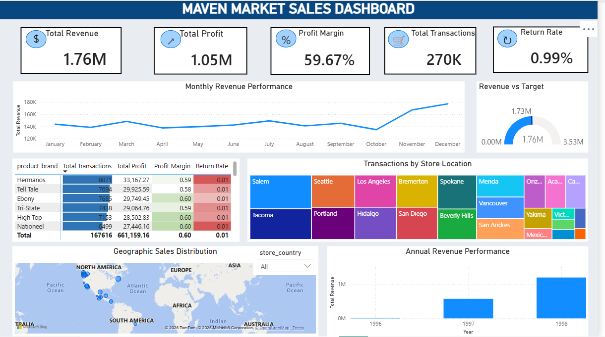
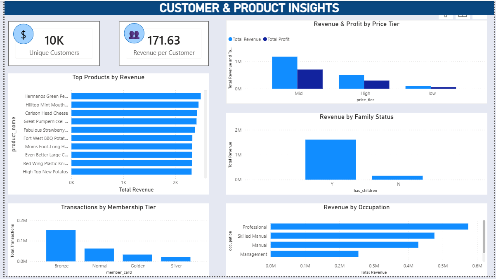

# Maven Market | Sales & Performance Analytics (Power BI)

A two-page interactive Power BI dashboard analysing sales, profit, returns, customers and products for a retail chain with stores across the USA, Canada and Mexico. Built on the Maven Market public practice dataset from Maven Analytics.

## Business Questions
- How are revenue, profit and returns performing over time?
- Which stores, brands and products perform best?
- Which customer segments generate the most revenue?
- Do higher-priced products actually deliver more profit?

## Dashboard Pages

### 1. Sales & Performance Analytics
- KPI cards: Total Revenue (1.76M), Total Profit (1.05M), Profit Margin (59.67%), Total Transactions (270K), Return Rate (0.99%)
- Monthly and annual revenue trends
- Revenue vs target gauge
- Brand performance table
- Transactions by store location and geographic sales map

### 2. Customer & Product Insights
- Unique Customers (10K) and Revenue per Customer (171.63)
- Top products by revenue
- Revenue and profit by price tier
- Revenue by family status and occupation
- Transactions by membership tier

## Key Insights
- Revenue rises sharply in the final two months of the year.
- Mid-price-tier products generate the most revenue and profit.
- Customers with children generate far more revenue than customers without.
- Professionals are the highest-revenue occupation group.

## Data Model
Star-schema model. `Fact_Transactions` connects to `MavenMarket_Products`, `MavenMarket_Stores`, `MavenMarket_Customers` and `MavenMarket_Calendar`. `MavenMarket_Returns` links through `product_id`.

## DAX Measures
| Measure | Purpose |
|---|---|
| Total Revenue | Quantity x product retail price (SUMX) |
| Total Cost / Total Profit | Quantity x product cost; revenue minus cost |
| Total Transactions, Quantity Sold | Row count and units sold |
| Quantity Returned, Return Rate | Units returned and returned / sold |
| Unique Customers | Distinct customer count |
| Revenue per Customer | Revenue / unique customers |
| Average Transaction Value | Revenue / transactions |
| Avg Items per Transaction | Units sold / transactions |

## Tools
Power BI Desktop, DAX, Power Query

## Data Source
Maven Analytics, Maven Market dataset (public practice dataset): https://mavenanalytics.io/data-playground

## Files
- `maven.pbix`: the full Power BI report
- `screenshots/`: dashboard images used above

## Author
Deepti Rawat | [GitHub](https://github.com/Deepti013)

